# ArknightsUID

GsCore 明日方舟插件，支持自有森空岛登录（凭据/扫码），也可回退复用 EndUID 登录凭据。

## 安装

首先参考核心安装：https://docs.sayu-bot.com/

```bash
cd gsuid_core/gsuid_core/plugins
git clone https://github.com/gugugaga55/ArknightsUID.git
```

渲染引擎二选一（详见下文[渲染引擎](#渲染引擎)）：

- **`takumi`（默认）**：无浏览器渲染，`uv pip install pytakumi`（或 `uv pip install -e ".[takumi]"`，聊天里 `ark安装依赖 takumi` 亦可），实测单卡 <0.1s。
- **`playwright`**：Chromium 截图，takumi 未安装/渲染失败时自动回退，无需配置。

Python 依赖（httpx、公招标签截图识别的 rapidocr 等）声明在 `pyproject.toml`，core 启动时会通过 AutoInstallDep（默认开）自动安装；极端环境自动安装失败时，管理员可发送 `ark安装依赖 ocr` 在聊天内补装（多镜像回退，装完即生效）。

## 功能

常用命令支持拼音首字母缩写（与 EndUID 的 `endmr` 同款习惯）：`ark每日=arkmr`、`ark理智=arklz`、`ark签到=arkqd`、`ark抽卡记录=arkck`、`ark攒抽=arkzc`、`ark公告=arkgg`、`ark面板=arkmb`、`ark公招=arkgz`、`ark公招推荐=arkgztj`、`ark肉鸽=arkrg`、`ark养成=arkyc`、`ark日历=arkrl`、`ark帮助=arkbz`。

### 账号登录（仅私聊；扫码登录可配置放行群聊）

<details><summary>展开/收起</summary>

- `ark绑定 <森空岛凭据>`: 绑定明日方舟账号（凭据为森空岛登录凭据，仅私聊）。
- `ark扫码登录`: 森空岛 APP 扫码登录（100 秒内有效）。默认仅私聊；管理员在插件配置开启「允许群聊扫码登录」（AllowGroupScanLogin）后群内可用——二维码对群内公开，100 秒内任何人扫码都会把 TA 的账号绑到发起人名下，仅建议熟人小群开启。
- `ark删除登录 [UID]`: 删除本地登录（不指定 UID 则全部删除）。
- `ark查看绑定`: 查看本地绑定的明日方舟账号。
- <details><summary>登录成功回执：账号写入卡（ark绑定 / ark扫码登录 通用，标注默认账号）</summary>

  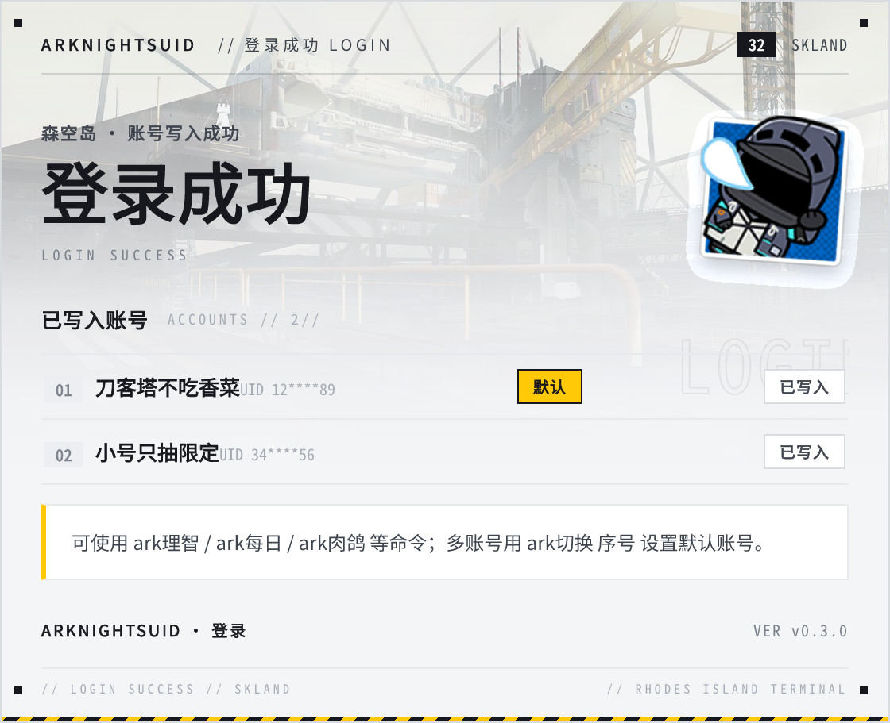

  </details>

</details>

### 状态查询（自有登录优先，无则回退 EndUID）

<details><summary>展开/收起</summary>

- <details><summary><code>ark账号</code> / <code>ark我的方舟</code>：查看当前可用的明日方舟账号（标注默认账号）</summary>

  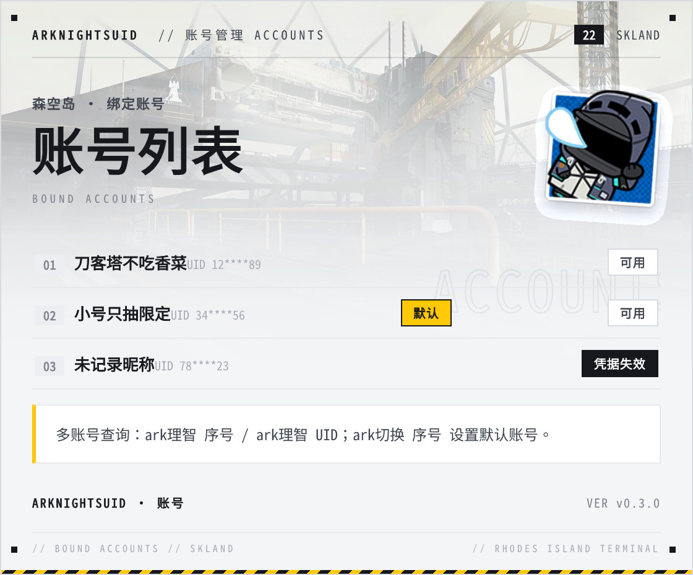

  </details>
- `ark切换 <序号|UID>`: 设置默认查询账号（多账号用户；不带参数查看当前默认）。
- `ark绑定列表`: 查看记录的明日方舟 UID 与凭据状态。
- <details><summary><code>ark理智</code> / <code>ark便签</code>：理智与基础状态卡（等级/注册天数/持有/剿灭）</summary>

  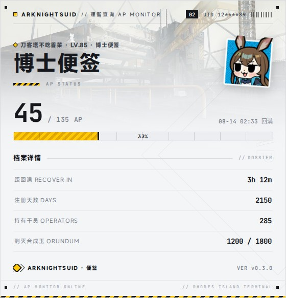

  </details>
- <details><summary><code>ark每日</code> / <code>ark日常</code>：日常 / 周常 / 剿灭进度卡</summary>

  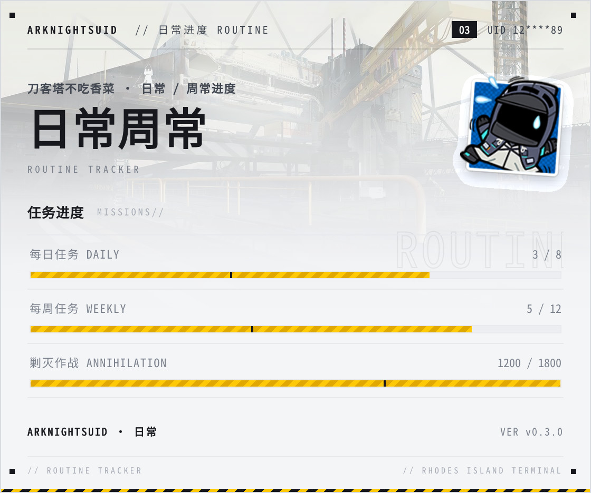

  </details>
- <details><summary><code>ark剿灭</code>：剿灭合成玉进度卡</summary>

  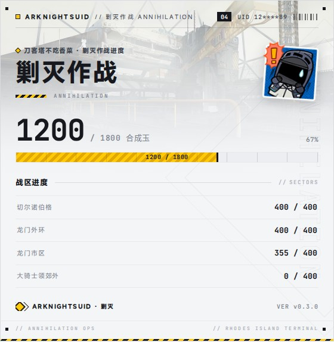

  </details>
- <details><summary><code>ark基建</code>：基建总览卡——控制中枢/无人机/线索/制造配方/贸易订单/宿舍氛围/训练室专精进度与剩余时间/公招槽位状态/低心情干员（换班提醒）</summary>

  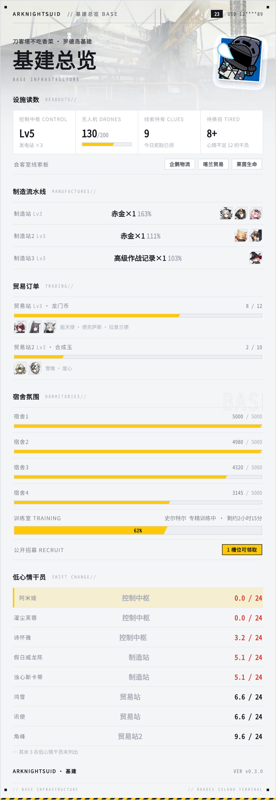

  </details>
- <details><summary><code>ark训练室</code>：训练室专精进度卡——受训干员立绘/在训技能与专精目标档/协助干员/剩余时间/预计完成时刻（targetSkill 一手字段，进度按目标档 8/16/24h 估算）</summary>

  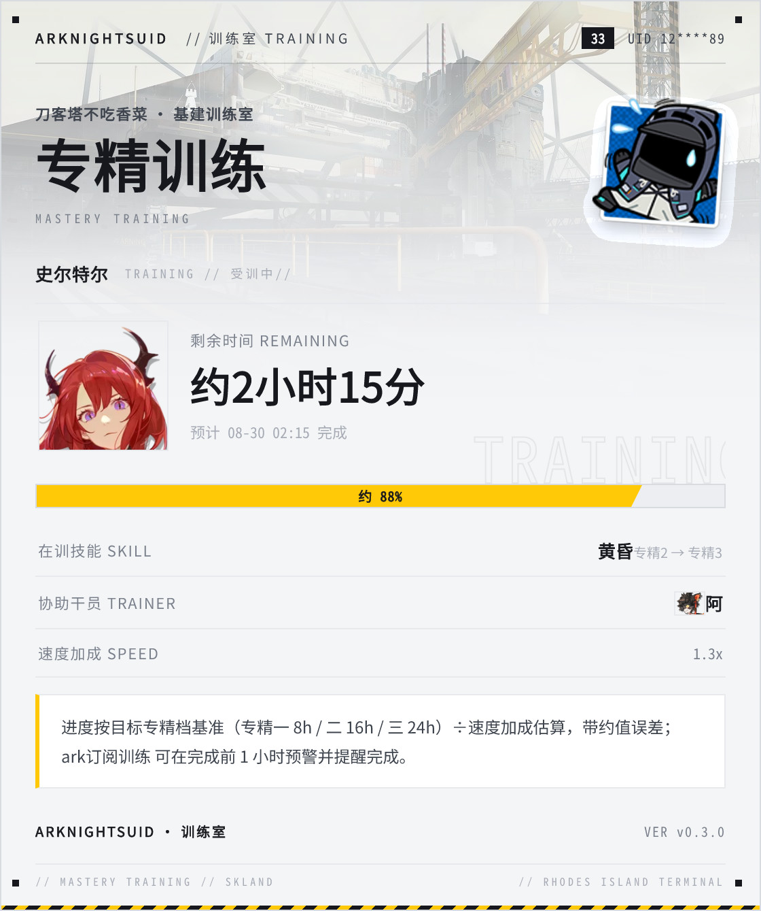

  </details>
- <details><summary><code>ark练度统计</code>：全干员练度统计卡（按职业分组的持有/精二/满级）</summary>

  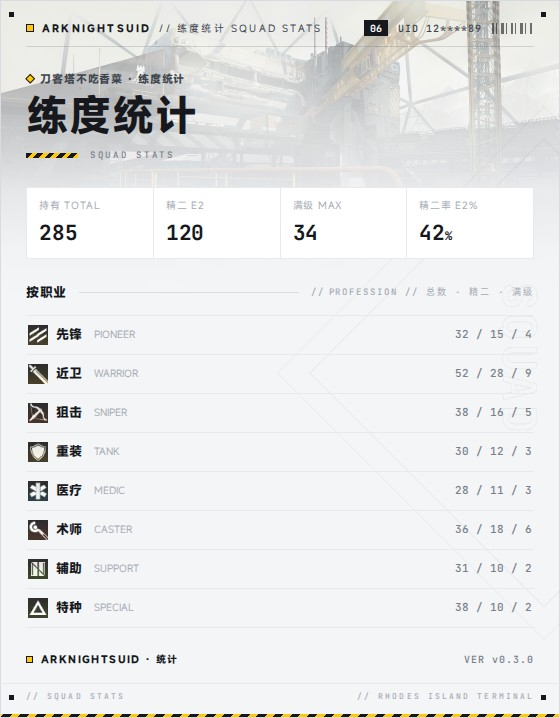

  </details>
- <details><summary><code>arkBOX</code> / <code>arkBOX分析</code>：BOX 稀有度分布与精英化分析卡</summary>

  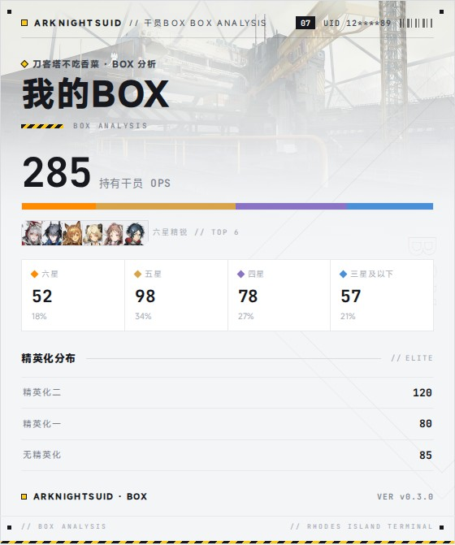

  </details>
- <details><summary><code>ark练度卡 &lt;干员名&gt;</code>：单干员练度卡（当前/满级技能效果、专精点、模组；支持中文全名 / 英文代号 / 唯一前缀 / 别名，如 <code>ark练度卡 42</code>）</summary>

  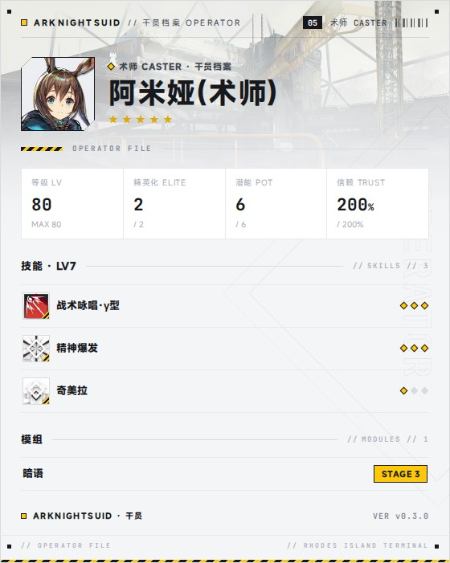

  </details>
- `ark理智 2` / `ark理智 123456789`: 按列表序号或 UID 查询指定账号。
- `ark签到` / `ark签到 2` / `ark签到 123456789`: 对默认或指定账号发起森空岛签到。
- <details><summary><code>ark肉鸽</code> / <code>ark集成战略</code>：查询肉鸽（集成战略）进度——最新期在前、合计通关/收藏小结（数据无结局/难度明细，接口仅此五项）</summary>

  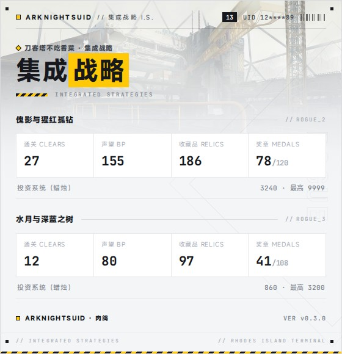

  </details>
- <details><summary><code>ark肉鸽敌人 &lt;名字&gt;</code>：肉鸽专用敌人 buff 面板——基础形态数值 + 所属期难度档累积加成（含新手档削减；数据 tomimi.dev 游戏解包，支持精确/前缀/子串匹配；期名支持简称与「X肉鸽」叫法：水月/萨米/萨卡兹/界园/树海等，如 <code>ark肉鸽敌人 汉科 树海 N15</code>；层数增益与交互式全 buff 模拟见 tomimi.dev）</summary>

  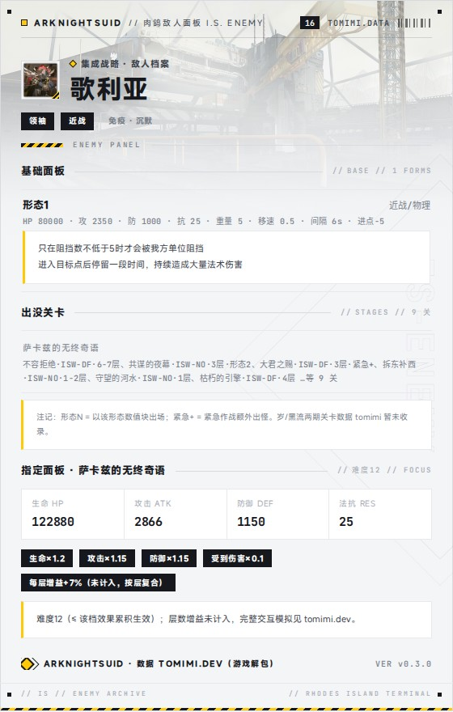

  </details>
- <details><summary><code>ark皮肤</code>：皮肤收集进度卡——已收集/目录/收集率、最近获得（带头像）、未收集清单（skin_table × player_info.skins，按系列排序）</summary>

  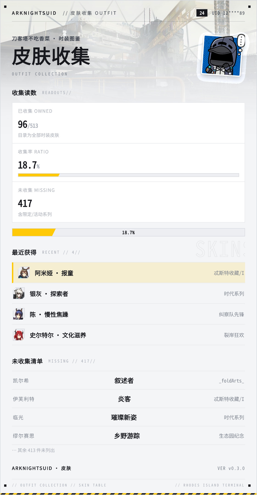

  </details>

</details>

### 抽卡与兑换（鹰角官网 OAuth 链）

<details><summary>展开/收起</summary>

- <details><summary><code>ark抽卡记录</code> / <code>ark抽卡分析</code>：增量拉取官方寻访记录并出统计卡（总抽数/六星率/平均/垫刀/最近六星）</summary>

  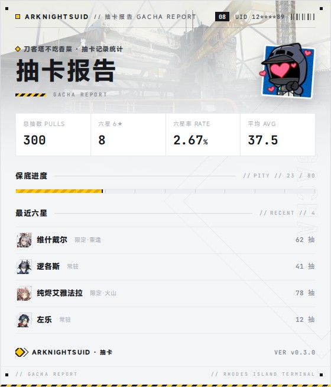

  </details>
- `ark兑换码 <code>`: 官网礼包码兑换（需要账号已保存森空岛登录态）。
- <details><summary><code>ark养成 &lt;干员名&gt;</code>：养成材料缺口计算——当前练度到毕业（精2/技能7/专精3/模组满级）所需材料对比仓库持有，支持别名（如 <code>ark养成 42</code>）</summary>

  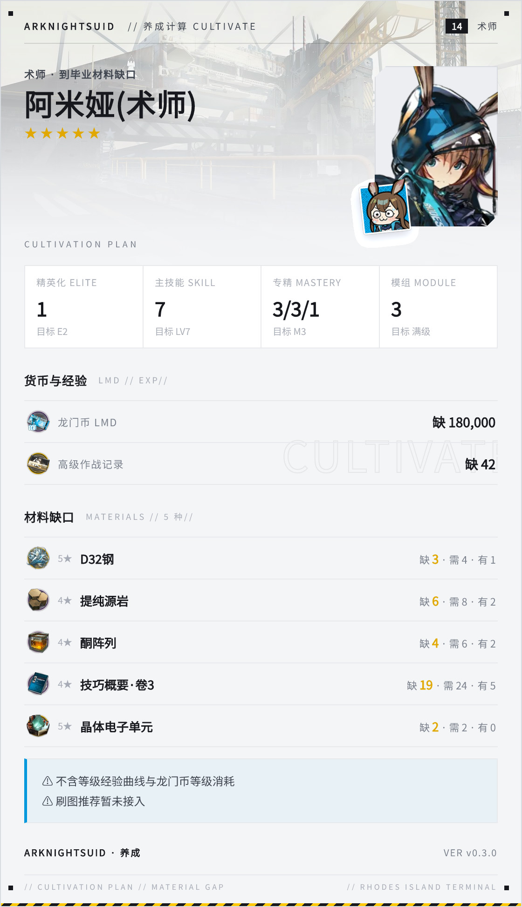

  </details>
- <details><summary><code>ark攒抽 [玉:60000] [石:30] [垫刀:20]</code>：攒抽规划——资源折算抽数 + 限定/井概率（口径同源一图流 gachaCalc，自动垫刀与当前卡池，支持 单/十 券、单UP/双UP、天数推演与目标抽数）</summary>

  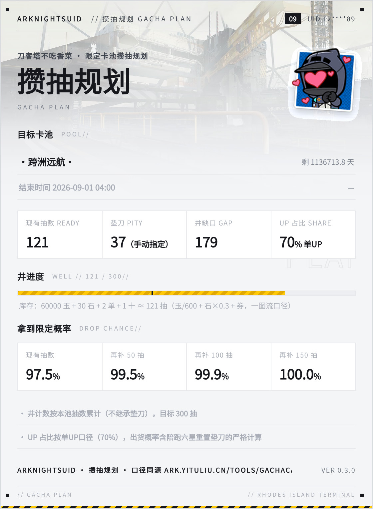

  </details>
- `ark年度 [年份]`: 寻访年度报告——本地记录的年度总抽数/六星率/最长垫刀/最肝月份纯文本总结。
- <details><summary><code>ark十连</code> / <code>ark单抽</code>：寻访模拟——官方概率（6★2%/5★8%/4★50%/3★40%）+ 十连保底 4★+，纯本地娱乐（不区分卡池、不累计垫刀），出结果卡</summary>

  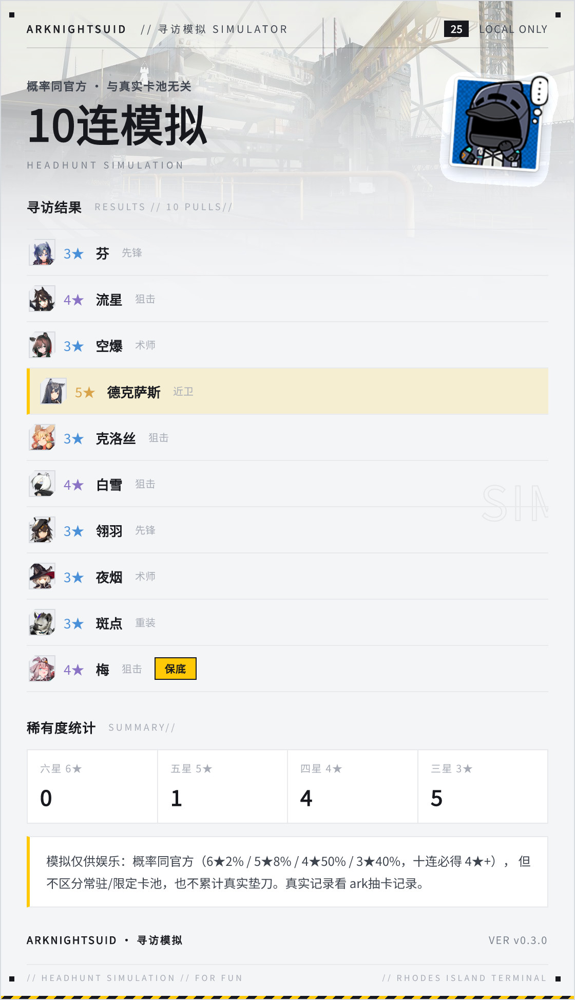

  </details>
- `ark导出抽卡`: 本地寻访记录导出 JSON 存档文件（info + 逐条记录：时间/池名/干员/稀有度/是否新获；文件发送失败回退摘要文本）。
- <details><summary><code>ark养成计划 &lt;干员名&gt;…</code>：多干员合并养成规划——最多 6 名干员到毕业的材料缺口合并（仓库持有只扣一次）+ 缺口前 5 的直刷 vs 合成建议，出卡</summary>

  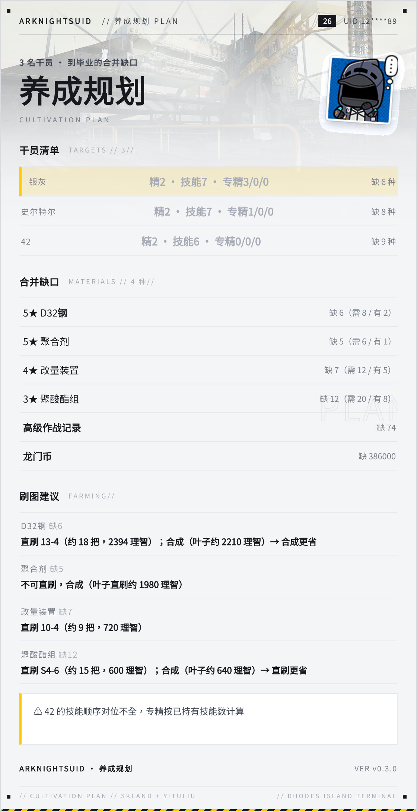

  </details>

</details>

### PRTS / Wiki

<details><summary>展开/收起</summary>

- <details><summary><code>arkwiki 词条</code>：查询 PRTS 词条摘要</summary>

  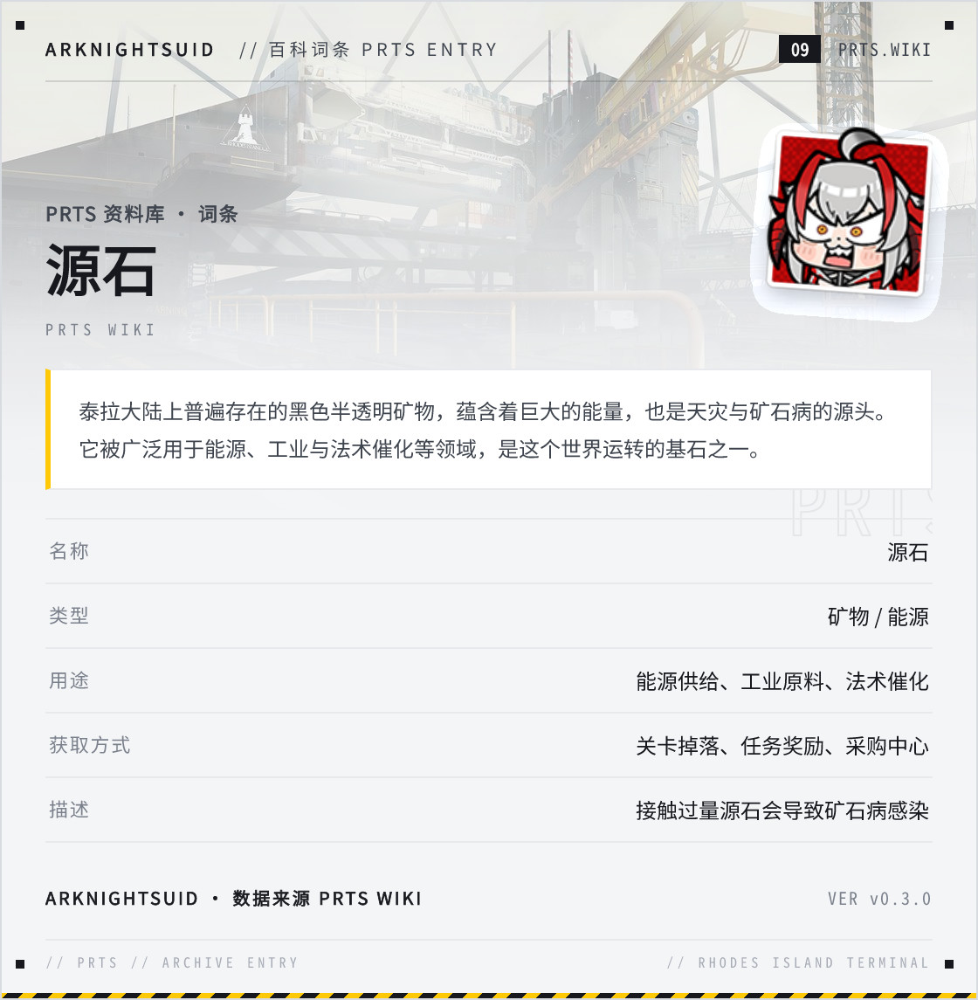

  </details>
- <details><summary><code>ark干员 干员名</code>：查询干员资料（技能逐级详情含伤害数值、天赋逐阶段与满潜数值；已绑定账号时附「我的练度」——当前技能/专精等级 vs 满级对比、专精训练剩余时间；支持别名，如 <code>ark干员 silverash</code>）</summary>

  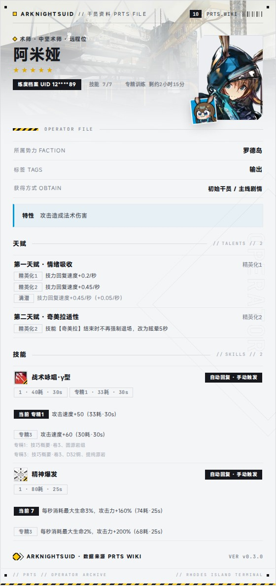

  </details>
- <details><summary><code>ark面板 &lt;干员名&gt; [精2] [Lv45/满级] [潜6/满潜] [技能2 专3] [X模/无模] [满好]</code>：干员面板模拟——默认取你自己的练度，可指定任意等级/潜能/模组/技能档出最终面板数值与来源拆解（数据 ArknightsGameData）</summary>

  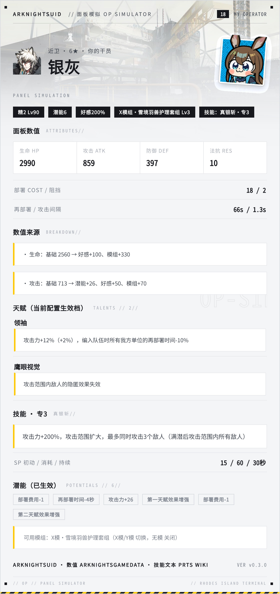

  </details>
- <details><summary><code>ark模组 &lt;干员名&gt;</code>：干员模组详情——类型/解锁条件（精英/等级/好感）/各级属性增量/解锁材料（ArknightsGameData uniequip/battle_equip）</summary>

  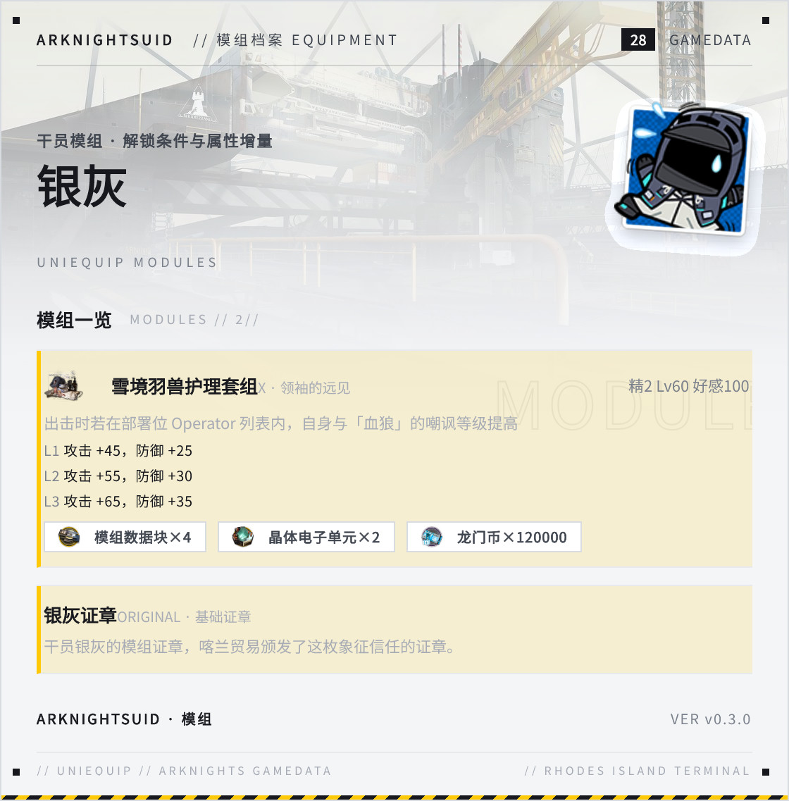

  </details>
- `ark语音 <干员名> [关键词]`: 干员中文台词查询（PRTS 语音记录子页，可按标题或内容过滤）。
- <details><summary><code>ark危机合约</code>：危机合约赛季时间线——新旧两制式 18 期全录（名称/起止时间，ArknightsGameData）</summary>

  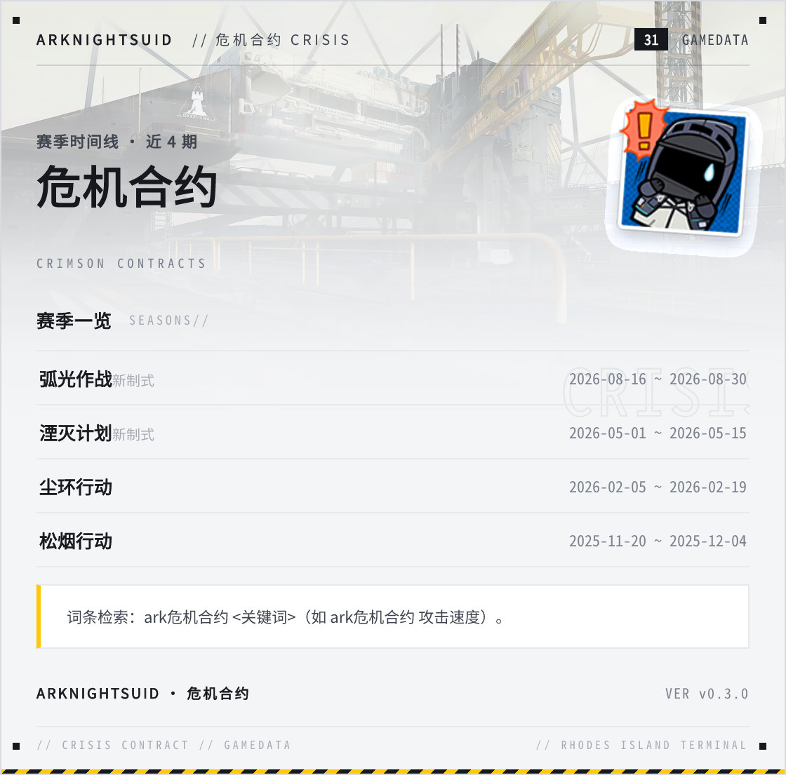

  </details>
- <details><summary><code>ark专精材料 干员名</code>：查询技能专精材料</summary>

  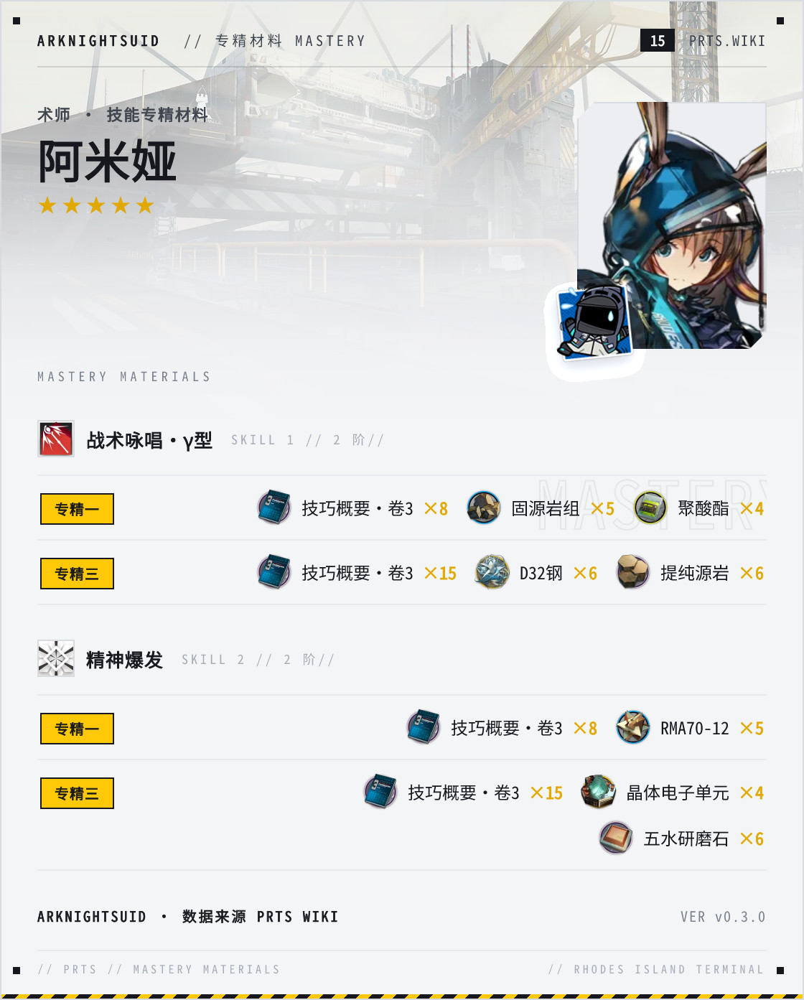

  </details>
- `ark材料 材料名`: 查询材料资料。
- <details><summary><code>ark敌人 敌人名</code>：查询敌人资料（基础数值、按类型分色的机制区块——技能黄/天赋蓝/能力墨色，含 SP 初始·消耗参数、等级 2 变体数值与独立机制）</summary>

  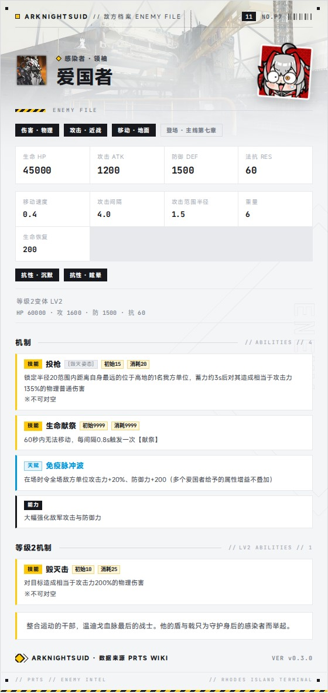

  </details>
- <details><summary><code>ark关卡 1-7</code>：查询关卡信息、掉落、敌方情报（含 HP/攻/防/抗基础数值）、关卡地图（PRTS 文件）与 PRTS.Map 交互链接；「作战条件」区块统一展示突袭条件（情报+数值差）、磨难/活动环境条件、全息作战矩阵指标（基础每组必选1/锁定指标/附加评分指标）与危机合约词条占位。支持磨难难度关（如 <code>ark关卡 磨难10-10</code>）与全息关（如 <code>ark关卡 全息H5-1</code>）</summary>

  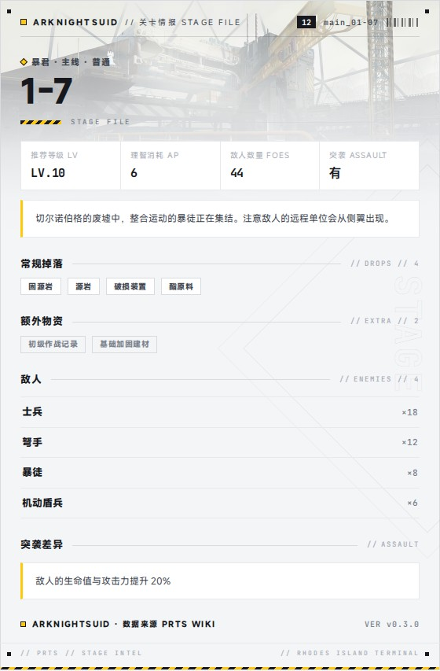

  </details>
- <details><summary><code>ark公招 标签1 标签2</code>：公招标签组合查询</summary>

  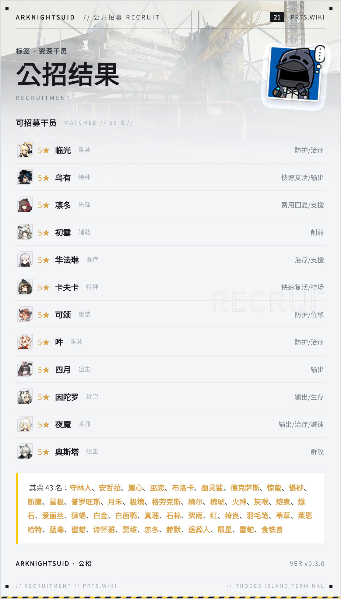

  </details>
- <details><summary><code>ark公招推荐 标签… / 截图</code>：公招组合推荐——把界面看到的标签全部输入（或直接发公招界面截图，本地 RapidOCR 识别，依赖随插件自动安装），枚举 1-3 标签组合按价值排行（6★ 保底 / 5★ 保底 / 4★ 保底），每个组合的池内干员**全量列出**；高资组合提示拉满 9 小时；池与标签口径 PRTS 公开招募页同步（资深=5★ 池、高级资深=6★ 池，未选高资时 6★ 不入池）</summary>

  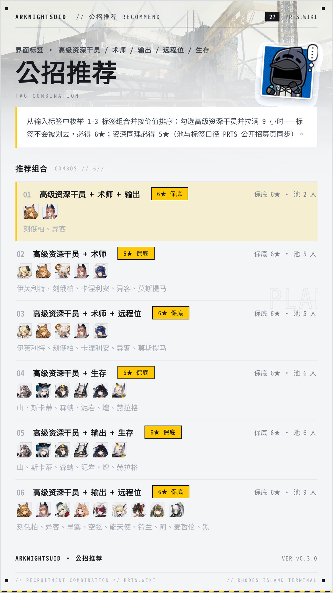

  </details>
- <details><summary><code>ark藏品 名字</code>：肉鸽（集成战略）藏品效果查询——跨全期按名聚合、同名去重（数据 ArknightsGameData，图标 tomimi.dev，支持前缀/子串唯一匹配）</summary>

  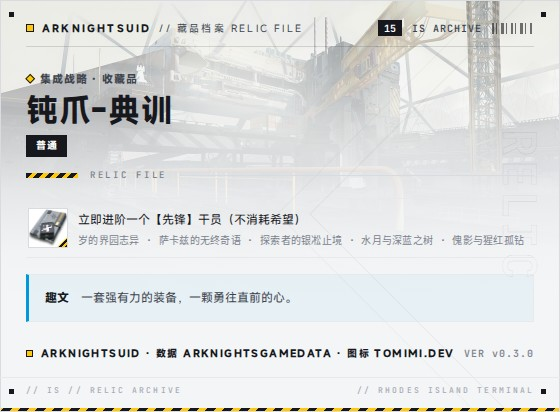

  </details>
- <details><summary><code>ark肉鸽关卡 &lt;关名&gt; [N难度] [紧急]</code>：肉鸽关卡出怪面板——该难度下全体敌人的折算数值与机制（tomimi.dev 开源数据，支持紧急作战折算，如 <code>ark肉鸽关卡 拆东补西 N15 紧急</code>）</summary>

  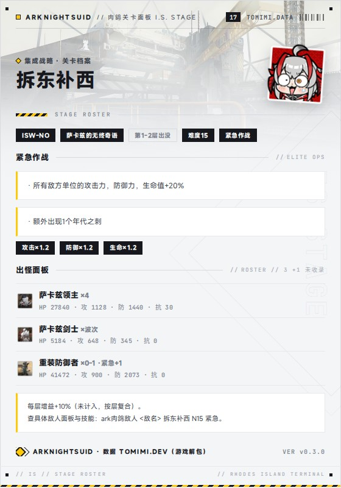

  </details>
- <details><summary><code>ark肉鸽结局 [期名/结局名/关键藏品名]</code>：各期肉鸽（集成战略）结局前置条件——结局名单来自游戏主题表（ArknightsGameData），前置链为内置攻略数据（PRTS 口径人工摘编）：前置解锁 / 达成步骤 / 关键藏品 / 最终关卡与 BOSS。期名支持简称（如 <code>ark肉鸽结局 萨卡兹</code>），也可按结局名（<code>ark肉鸽结局 双王记</code>）或关键藏品名反查（<code>ark肉鸽结局 巴别塔誓言</code>）；新 DLC 结局上线后攻略数据随版本更新</summary>

  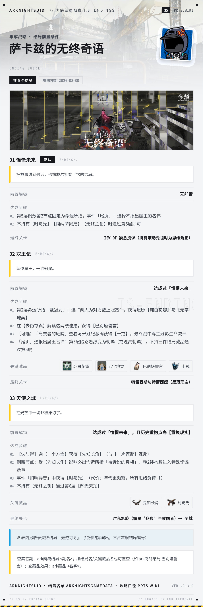

  </details>
- <details><summary><code>ark日历</code>：活动 / 卡池日历</summary>

  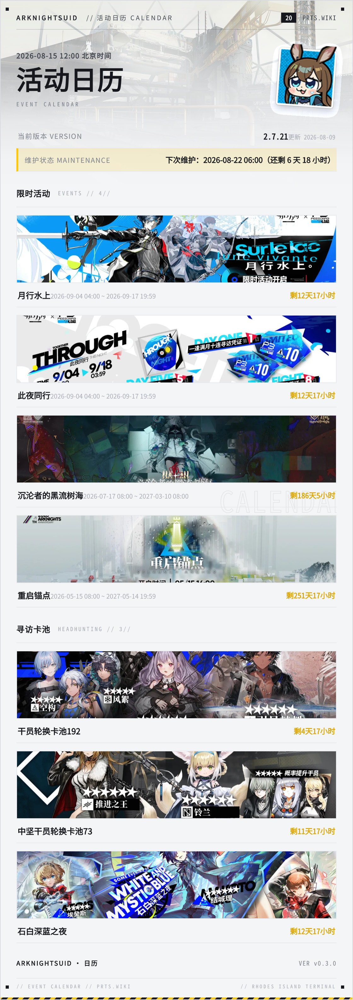

  </details>

</details>

### 活动与推送（PRTS + 森空岛 web + 一图流）

<details><summary>展开/收起</summary>

- <details><summary><code>ark活动</code> / <code>ark活动列表</code>：进行中 / 即将开始的限时活动与限定卡池清单</summary>

  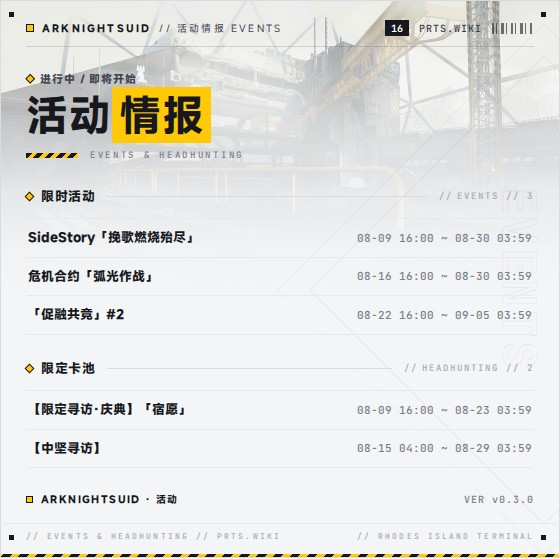

  </details>
- <details><summary><code>ark公告 [编号]</code>：明日方舟官方公告列表（森空岛 web 端，含链接）；带编号查看对应公告正文卡片（段落按原帖顺序还原）</summary>

  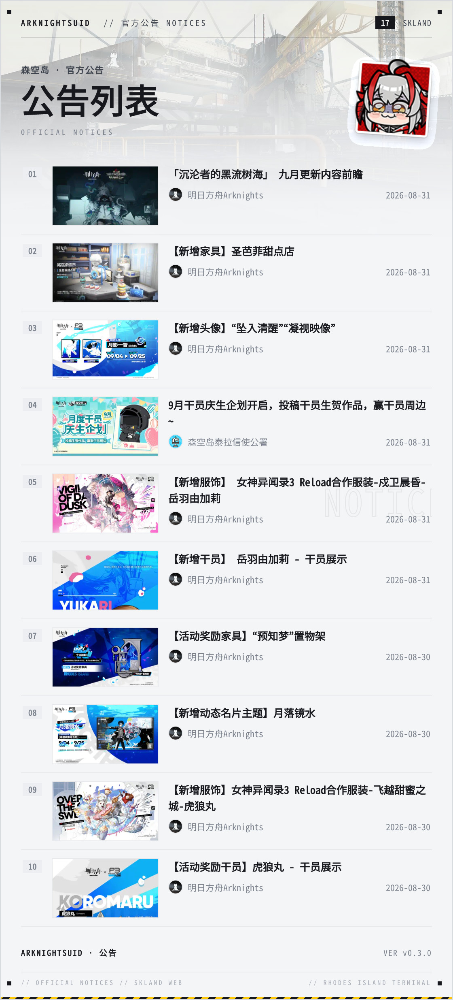

  

  </details>
- <details><summary><code>ark刷图推荐 [主线|别传|限时活动|资源收集]</code>：关卡效率榜（一图流 spm，默认三组混排）</summary>

  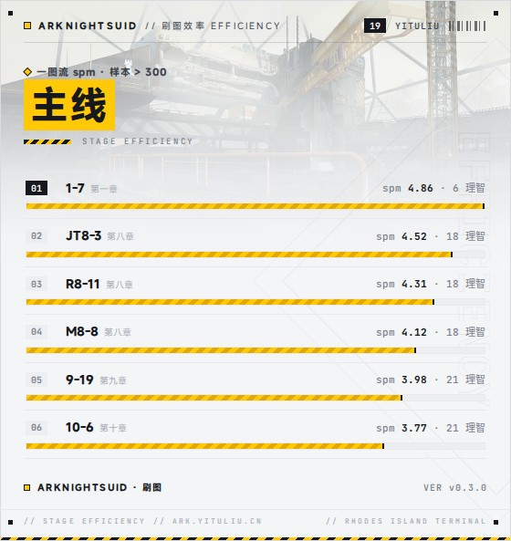

  </details>
- <details><summary><code>ark材料掉率 &lt;材料名&gt;</code>：材料掉落关卡统计——每把期望件数、单件期望理智、样本量（一图流 COS 掉落矩阵，样本 &gt;300 才收录）</summary>

  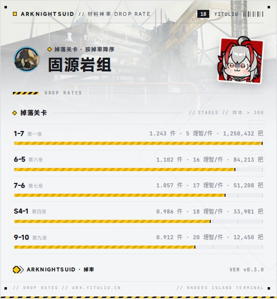

  </details>
- <details><summary><code>ark合成 &lt;材料名&gt;</code>：加工站合成树——产出/龙门币/子材料递归展开（ArknightsGameData workshopFormulas）</summary>

  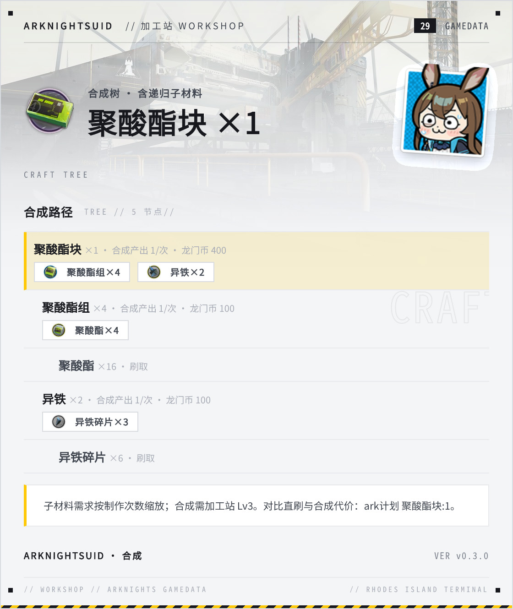

  </details>
- <details><summary><code>ark计划 &lt;材料:数量 …&gt;</code>：刷图规划——每个目标的直刷关卡（期望理智/把数） vs 合成路径（叶子材料成本）对比与合计理智</summary>

  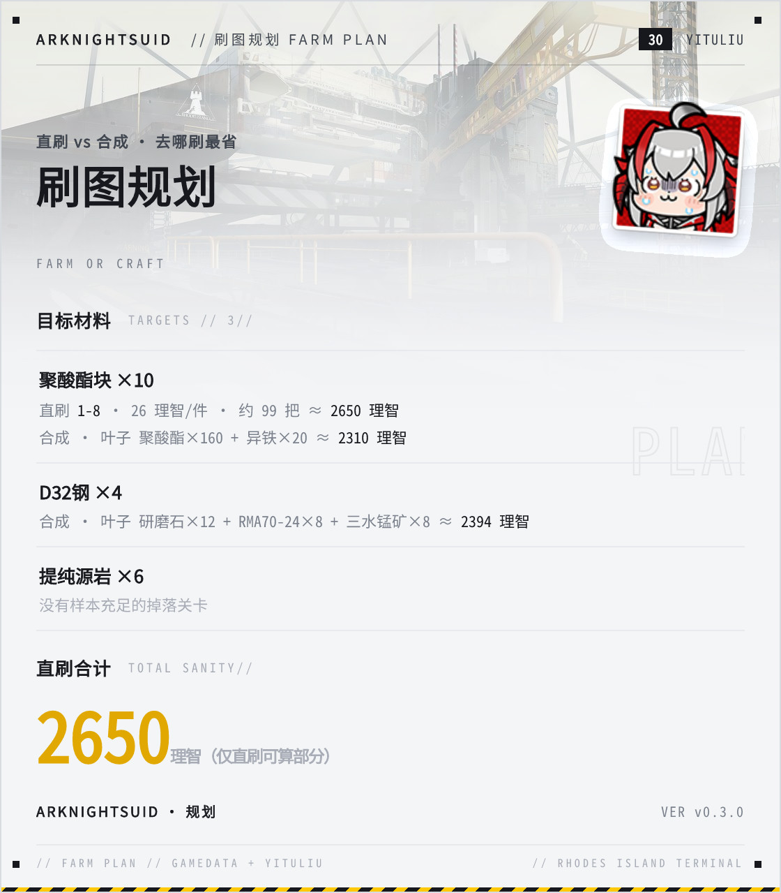

  </details>
- `ark订阅剿灭 [序号|UID]` / `ark取消订阅剿灭`: 剿灭周提醒——每周五 20:00 检查本周合成玉，未拿满提醒一次。
- `订阅方舟活动` / `取消订阅方舟活动`: 群聊订阅推送——新活动 / 新卡池 / 新公告自动通知（30 分钟轮询）。
- `ark订阅公告` / `ark取消订阅公告`: 官方公告专项推送（群聊/私聊均可）——仅推新公告，推送时随文案一并发出官方封面图（纯文字公告或图挂时自动降级纯文字），订阅时播报最近公告，与「订阅方舟活动」互不影响（共用轮询间隔配置）。
- `ark订阅理智 [序号|UID]` / `ark理智推送`: 理智回满推送——回满时提醒一次，用理智后自动恢复提醒（10 分钟轮询，可多账号分别订阅）。
- `ark取消订阅理智 [序号|UID]`: 取消理智回满推送（不带参数取消全部）。
- `ark订阅训练 [序号|UID] [提前量]` / `ark训练推送`: 专精训练推送——订阅时即时播报当前在训干员与剩余时间（「剩约5小时2分完成，预计 08-30 14:23 到点」）；剩余时间进入提前量窗口（如 `ark订阅训练 5小时`，默认 1 小时）先预警一次「还剩约X小时Y分完成」，完成后提醒一次；换干员开新一轮后自动恢复（10 分钟轮询，可多账号分别订阅）。
- `ark取消订阅训练 [序号|UID]`: 取消专精训练推送（不带参数取消全部）。
- `ark订阅基建 [序号|UID]` / `ark基建推送`: 基建事件推送——无人机回满 / 贸易订单满 / 干员心情过低待换班 / 公招完成可领取，各提醒一次，处理后自动恢复（15 分钟轮询，可多账号分别订阅）。
- `ark取消订阅基建 [序号|UID]`: 取消基建推送（不带参数取消全部）。
- `ark订阅签到 [序号|UID]` / `ark自动签到`: 每日自动签到——每天 08:05 自动完成森空岛签到并回报结果（今日已签静默，失败会提示手动重试）。
- `ark取消订阅签到 [序号|UID]`: 取消自动签到（不带参数取消全部）。
- 凭据失效主动提醒：任一订阅轮询发现登录不可用时提醒一次「请重新 ark绑定」（7 天冷却，防轰炸）。

</details>

### 个性化与娱乐

<details><summary>展开/收起</summary>

- `ark别名 <别名>=<干员名>` / `ark别名列表` / `ark别名删除 <别名>`: 用户自定义干员别名，对 ark干员/面板/养成/练度卡/模组 生效（优先级高于内建别名）。
- `ark肉鸽别名 <别名>=<期名>` / `ark肉鸽别名列表` / `ark肉鸽别名删除 <别名>`: 用户自定义肉鸽期名（如 `ark肉鸽别名 树海=沉沦者的黑流树海`），对 ark肉鸽敌人/ark肉鸽关卡/ark肉鸽结局 的期名参数生效（优先级高于内建期名）。
- <details><summary><code>ark抽签</code>：明日方舟主题每日运势卡（同人一天固定；同行干员带初始头像与星级，纯娱乐）</summary>

  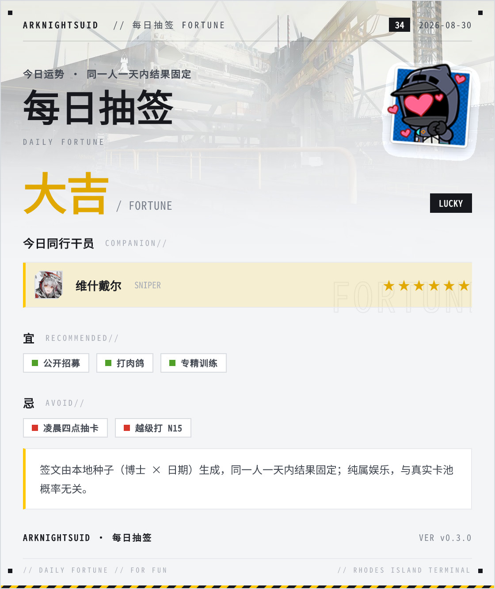

  </details>
- `ark帮助搜索 <关键词>`: 按关键词检索命令（如 `ark帮助搜索 肉鸽`）。

</details>

### 帮助

<details><summary>展开/收起</summary>

- <details><summary><code>ark帮助</code>：查看插件帮助卡</summary>

  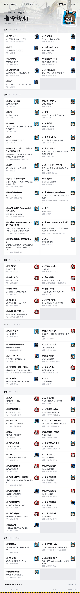

  </details>

- <details><summary><code>ark下载资源 [分类]</code>（管理员）：批量预下载全部渲染图片</summary>

  各卡片渲染的图片（干员头像/立绘、技能/模组/物品/敌人图标、关卡地图等）默认惰性下载，首次查询会慢。此命令按当前游戏数据表一次性预下载全集：已存在的图片直接跳过（并刷新保留时间），因此**重跑只补新增 diff**，建议每月跑一次（缓存清理按 30 天保留过期文件）。进度不逐类刷屏，全部跑完后以一条**转发消息**汇总各分类统计与总结发回（平台不支持转发时自动退回纯文本）。

  可选分类参数（不带则全部）：`头像`、`立绘`、`技能`、`职业`、`物品`、`敌人`、`模组`、`地图`、`肉鸽地图`。其中立绘体积最大，可单独执行 `ark下载资源 立绘`。附加「校验」参数（如 `ark下载资源 校验`）进入存量校验模式：已存在的文件逐个做图片结构校验，损坏或 0 字节残档删除后自动重下——普通模式下存量坏档不会被发现。日常使用的惰性下载链自带自愈：缓存文件打不开时会删除重下一次，不会永久无图。

  </details>

- <details><summary><code>ark安装依赖 [名字]</code>（管理员）：兜底补装插件依赖</summary>

  依赖通常由 core 启动时自动安装（AutoInstallDep 读 <code>pyproject.toml</code>，多镜像回退）。自动安装失败（镜像不可达 / 关闭了自动安装等）时用本命令在聊天内补装：白名单限定本插件声明的依赖（<code>ark安装依赖 ocr</code> 装 RapidOCR、<code>ark安装依赖 takumi</code> 装 pytakumi），不接受任意包名；目标包均为惰性导入，装完即生效无需重启。不带参数发送可查看各依赖安装状态。

  </details>

</details>

## 说明

本插件**优先使用自有森空岛登录**（`ark绑定`/`ark扫码登录` 写入本地 `ArkUser` 表）。若未自有登录，则回退读取 EndUID 的 `EndUser(game_id=1)`——EndUID 从硬依赖降级为可选回退。

凭据复用范围：

- 自有登录凭据或 EndUID 的登录态会作为接口请求凭据使用。
- 接口缓存登录态失效时会自动刷新。
- 其他可复用登录态仅在内部使用，不会在命令输出中展示。

安全约束：命令回复、帮助和 README 都不会输出森空岛登录凭据或接口缓存登录态明文；绑定/登录命令仅在私聊可用（群聊会被拒绝并提示），扫码登录可由管理员开启「允许群聊扫码登录」放行群聊（默认关）。

## 安全说明

凭据存储与加密：

- 自有登录的森空岛登录凭据、官网抽卡链凭据与短期访问凭据均以 **Fernet 密文**（`enc:v1:` 前缀）落库；旧明文行读取时自动兼容，下次写入自动升级为密文，无需停机迁移。
- 加密密钥优先取环境变量 `ARK_UID_ENC_KEY`（生成方式：`python -c "from cryptography.fernet import Fernet; print(Fernet.generate_key().decode())"`）；未设置时自动生成密钥文件并存于插件数据目录（文件 0600、目录 0700）。更高安全要求请用环境变量注入并把密钥与数据目录分开存放。
- **密钥文件丢失/更换后密文凭据将解密失败**，表现为账号凭据失效，重新 `ark扫码登录` 即可自愈。
- 仍然明文的：EndUID 回退读取的行属 EndUID 插件自己的存储，本插件只读不动；玩家数据缓存（player_info 等）不含凭据。
- 请保持 gsuid_core 数据目录仅限运行用户可读；数据库与密钥文件被一同拿走时加密无法防御（同机存放是可用性取舍）。

其他安全行为：

- 绑定/登录仅私聊（扫码登录可经「允许群聊扫码登录」配置放行群聊，默认关）；回复中的 UID 默认脱敏（`HideUid` 默认开）；外部 API 报错回显前统一抹去敏感凭据类键值。
- 外置渲染（`RemoteRenderEnable`）会把完整卡片 HTML（含昵称、UID、游戏数据）发送到 `RemoteRenderUrl`——仅指向自建/受信任服务，公网务必 HTTPS。
- 代码中的 `APP_CODE`、数美指纹 DES 密钥等为逆向公开协议常量，非机密；登录凭据传递建议首选 `ark扫码登录`，`ark绑定 <森空岛凭据>` 会使凭据经过 IM 服务器，仅作兜底。

## 渲染引擎

本地 HTML→图片渲染支持两种引擎（配置项 `RenderEngine`，外置渲染不受影响）：

- **`takumi`（默认）**：[pytakumi](https://github.com/KimigaiiWuyi/pytakumi) 无浏览器渲染，进程内完成，无 Chromium 常驻内存，实测单卡 <0.1s（Playwright 同卡约 10s）。安装：`uv pip install pytakumi`（或 `uv pip install -e ".[takumi]"`）。系统存在 Noto Sans CJK 时自动注册为离线字体兜底（远程 MiSans CSS 失效时仍出正常中文）。
- **`playwright`**：Chromium 截图，作为 takumi 未安装/渲染失败时的自动回退（无需配置）。

两种引擎产物均为 560px 宽 JPEG（与 `.container` 设计宽一致）；模板约定 `body` 无 margin、`.container` 顶格，两引擎输出画面等价。

## 丨其他

+ 本项目仅供学习使用，请勿用于商业用途。使用本插件视为同意提供用户凭据，用户凭据仅用于查询游戏数据。使用本插件造成的任何数据滥用行为与作者无关。


## 致谢

- [EndUID](https://github.com/Loping151/EndUID) · [Loping151](https://github.com/Loping151) — 151 很棒的，咕咕嘎嘎
- [arknights-plugin](https://github.com/gxy12345/arknights-plugin) — 功能对标与鹰角 OAuth 抽卡链参考
- [gsuid_core](https://docs.sayu-bot.com/) — 插件运行核心
- [PRTS Wiki](https://prts.wiki/) — 词条/关卡/公招数据与图片资源
- [tomimi-dev](https://github.com/tanch-p/tomimi-dev) — 肉鸽藏品与敌人数据
- [Kengxxiao/ArknightsGameData](https://github.com/Kengxxiao/ArknightsGameData) — 游戏数据表镜像
- [一图流](https://ark.yituliu.cn/) — 攒抽规划折算与保底口径参考
- [森空岛 Skland](https://www.skland.com/) — 玩家数据来源
- [pytakumi](https://github.com/KimigaiiWuyi/pytakumi) — takumi 渲染引擎
